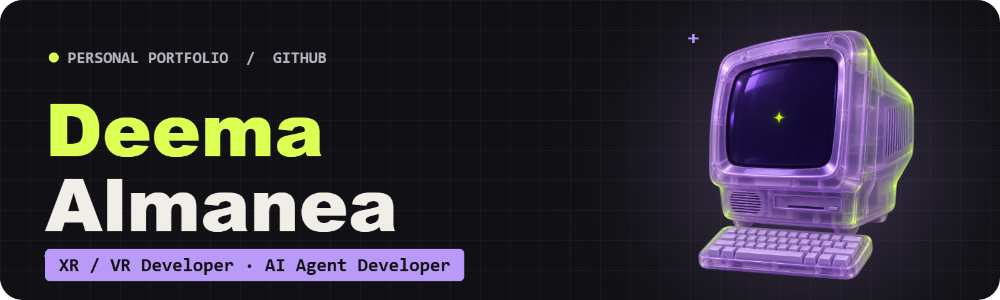
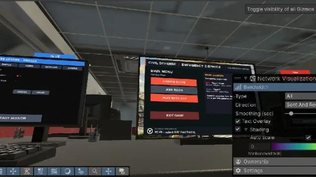
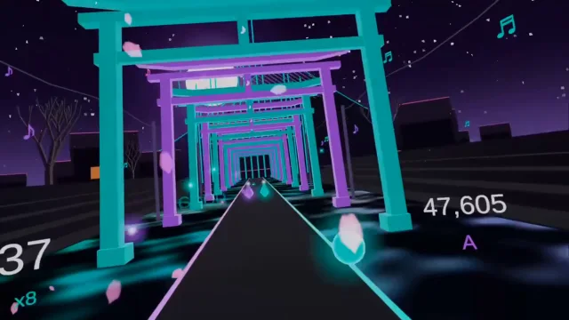
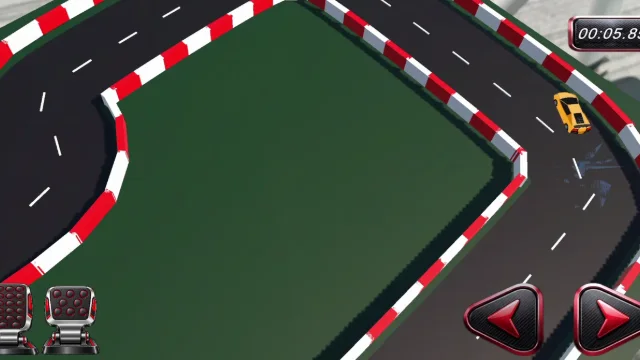
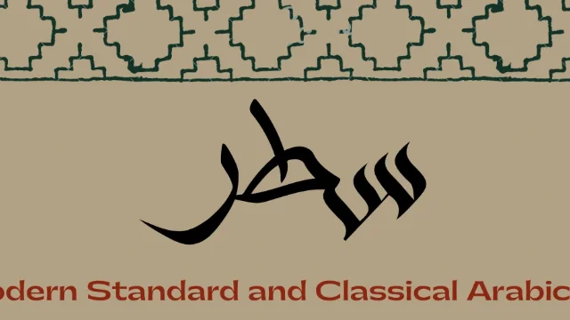
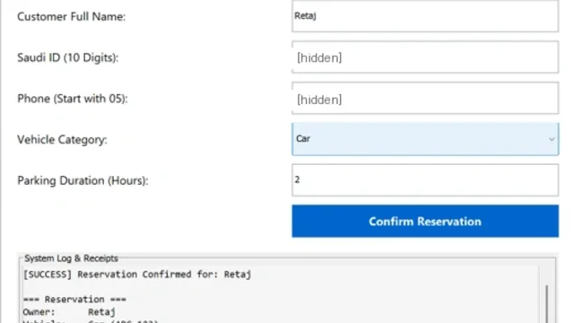
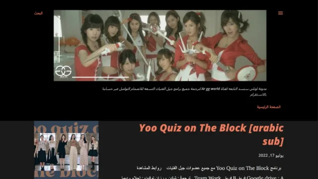
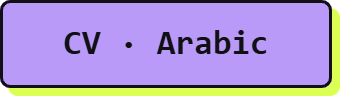

 

<a href="https://deematm.github.io/portfolio/?lang=ar">النسخة العربية من الموقع</a>

 

### ✳ About

I’m an XR and VR developer and an AI agent developer studying Artificial Intelligence at Princess Nourah bint Abdulrahman University. I build interactive experiences in Unity and experiment with hardware that connects physical controls to digital environments. My creative work spans UI and web design, photo and video editing, and translation.

 

### ✳ Featured projects

<table>
  <tr>
    <td width="50%" valign="top">
      
       <b>Firefighters VR</b>
       MULTIPLAYER VR · IOT
       A two-player emergency-response game with a physical steering wheel and an Arduino alarm light.
    </td>
    <td width="50%" valign="top">
      
       <b>Musical VR</b>
       HEADSET VR · RHYTHM GAME
       A Japanese-inspired VR rhythm game with a sakura village lobby and playable drum and piano lessons.
    </td>
  </tr>
  <tr>
    <td width="50%" valign="top">
      
       <b>AR Racing</b>
       MOBILE AR · TIME TRIAL
       A two-player time trial on a custom racetrack placed on the floor through the phone camera.
    </td>
    <td width="50%" valign="top">
      
       <b>SATAR</b>
       TEAM PROJECT · ARABIC NLP / ARABTHON
       An Arabthon project that restores punctuation to Arabic text using linguistic context.
    </td>
  </tr>
  <tr>
    <td width="50%" valign="top">
      
       <b>Smart Parking System</b>
       COURSE TEAM PROJECT · JAVA / JAVAFX
       A Java application for tracking vehicles, parking reservations, and payments.
       <a href="https://deematm.github.io/portfolio/assets/smart-parking-system.pdf">Full report (PDF) ↗</a>
    </td>
    <td width="50%" valign="top">
      
       <b>Only SNSD</b>
       WEB PUBLISHING · ARABIC SUBTITLES
       An SNSD fan hub I customized on Blogger, with Arabic-subtitled Korean variety episodes.
       <a href="https://onlysnsd1.blogspot.com/?m=1">Visit Only SNSD ↗</a>
    </td>
  </tr>
</table>

Full case studies, gameplay videos, and behind-the-scenes shots are on my <a href="https://deematm.github.io/portfolio/#work">portfolio</a>.

 

### ✳ Skills

**XR & games** — Unity XR / VR · Mobile AR plane detection · Image-target AR · Multiplayer · Spatial interfaces · Rhythm charting & hit detection

**AI & language** — Arabic NLP · Model fine-tuning · Python note analysis

**Software** — Java · JavaFX · Object-oriented design · UML

**Hardware** — Arduino · Physical controls for VR

**Creative** — UI & web design · Blogger customization · Korean → Arabic subtitling · Aegisub timing · Photo & video editing

 

### ✳ Contact

  &nbsp;
  &nbsp;
  

Deemalmane3@gmail.com · <a href="https://deematm.github.io/portfolio/">deematm.github.io/portfolio</a>
